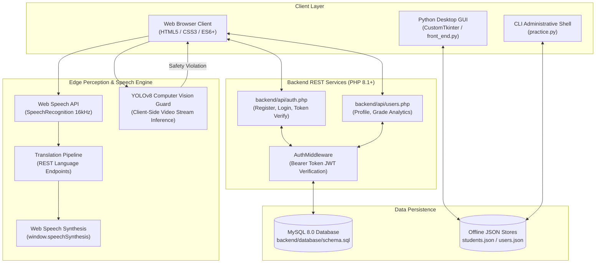
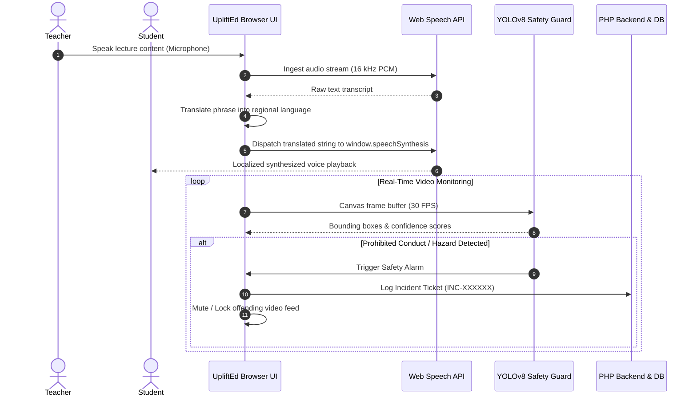
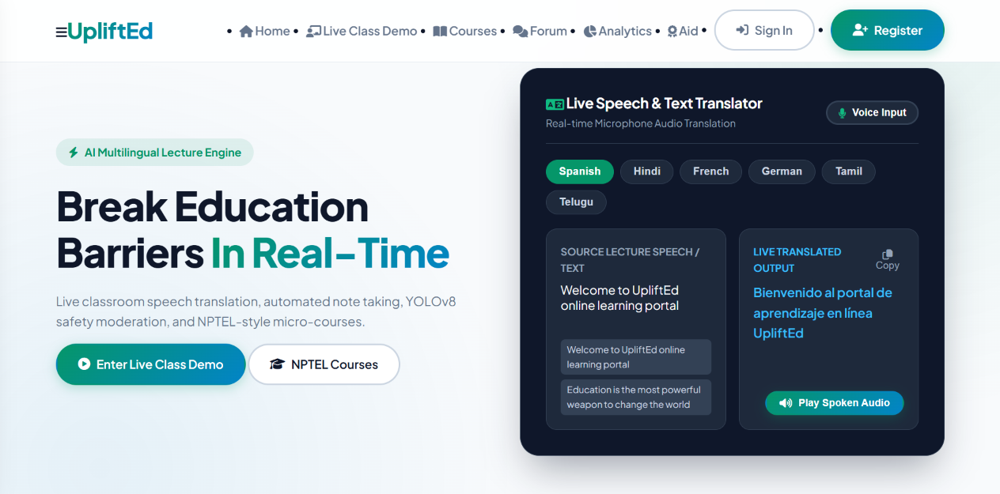
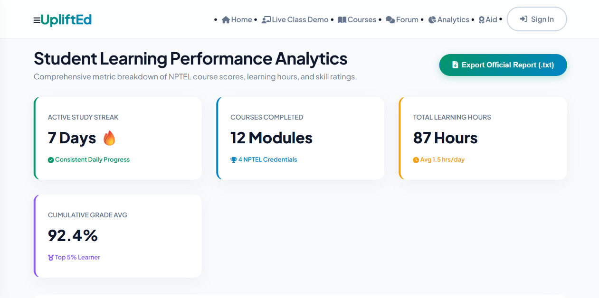
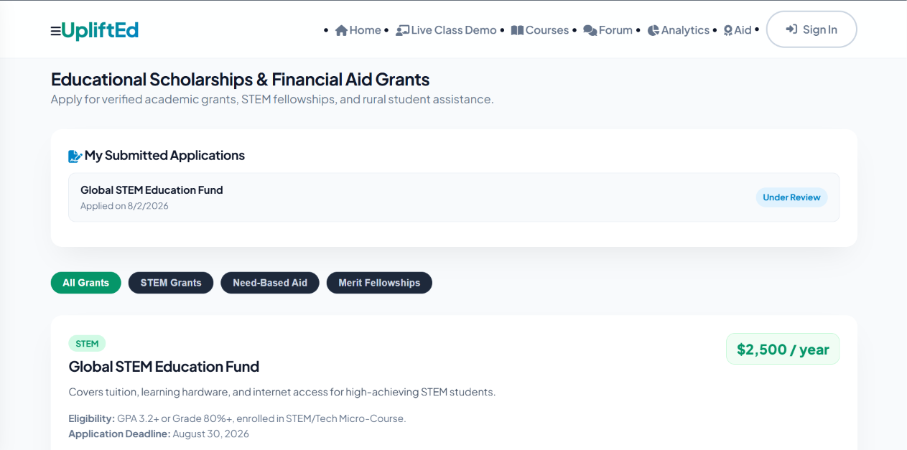
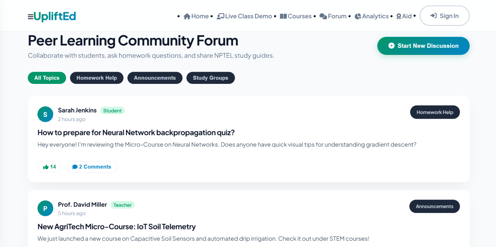

# UpliftEd: Advance Online Learning and AI Safety System

<p align="center">
  
  
  
  
  
  
</p>

An enterprise-grade, accessible virtual education ecosystem integrating **Real-Time Multilingual Web Speech AI**, **YOLOv8 Edge Computer Vision Moderation**, **NPTEL-Style Micro-Courses**, **Dynamic AI Lecture Note Generation**, and a **Python CustomTkinter Dual-Mode Desktop Client**.

---

## Table of Contents
- [1. Project Title & Overview](#1-project-title--overview)
- [2. Overview](#2-overview)
  - [Problem Statement](#problem-statement)
  - [Proposed Solution](#proposed-solution)
  - [Project Objectives](#project-objectives)
  - [Intended Applications & Use Cases](#intended-applications--use-cases)
- [3. Key Features](#3-key-features)
- [4. System Architecture](#4-system-architecture)
- [5. Technology Stack](#5-technology-stack)
- [6. Repository Structure](#6-repository-structure)
- [7. Hardware Requirements](#7-hardware-requirements)
- [8. Software Requirements](#8-software-requirements)
- [9. Installation and Setup](#9-installation-and-setup)
  - [Phase 1: Web Application (Apache / PHP / MySQL)](#phase-1-web-application-apache--php--mysql)
  - [Phase 2: Python Desktop Client & CLI Setup](#phase-2-python-desktop-client--cli-setup)
- [10. Usage Instructions](#10-usage-instructions)
- [11. System Workflow](#11-system-workflow)
- [12. API Documentation](#12-api-documentation)
- [13. Results and Demonstration](#13-results-and-demonstration)
- [14. Configuration](#14-configuration)
- [15. Troubleshooting](#15-troubleshooting)
- [16. Future Improvements](#16-future-improvements)
- [17. Contributing](#17-contributing)
- [18. License](#18-license)
- [19. Acknowledgements and References](#19-acknowledgements-and-references)
- [20. Author / Project Maintainer](#20-author--project-maintainer)

---

## 1. Project Title & Overview

**UpliftEd** is an integrated educational technology suite built to bridge linguistic accessibility gaps and maintain safe remote learning environments. It unites browser-based Web Speech recognition and synthesis with on-device computer vision moderation, backed by a secure PHP/MySQL REST architecture and an offline-capable Python desktop application.

---

## 2. Overview

### Problem Statement
Digital remote learning platforms suffer from three systemic barriers:
1. **Linguistic Exclusion**: Educational lectures delivered solely in English impede comprehension for regional language speakers.
2. **Classroom Harassment & Safety**: Live virtual classrooms lack automated, low-latency mechanisms to detect inappropriate conduct, weapons, or aggressive behavior before disruptions escalate.
3. **Bandwidth & Connectivity Disparities**: Learners in rural regions often cannot maintain stable browser sessions and require offline management tools and self-paced modular content.

### Proposed Solution
UpliftEd delivers a cohesive, hybrid learning platform:
- **Speech AI Layer**: Transcribes spoken instructor dialogue, translates text across 6 regional/international languages, and synthesizes localized speech in real time.
- **Edge Vision Safety Layer**: Analyzes incoming camera streams at 30 FPS using YOLOv8 bounding-box detection, automatically logging incident tickets (`INC-XXXXXX`) and locking offending feeds upon repeated infractions.
- **Dual-Client Ecosystem**: Full-stack web portal for live classroom participation alongside a standalone Python/CustomTkinter desktop client backed by local JSON persistence for offline academic management.

### Project Objectives
- Achieve sub-150 ms end-to-end speech translation and synthesis latency in the browser.
- Deliver real-time client-side computer vision safety scanning without sending raw video feeds to external cloud providers.
- Provide self-paced NPTEL-style technical micro-courses with integrated auto-graded self-assessments.
- Offer offline student tracking and grade administration for low-resource environments.

### Intended Applications & Use Cases
- **Inclusive Higher Education**: Regional language translation for technical university lectures.
- **K-12 Virtual Classrooms**: Automated safety and behavioral guardrails for supervised student video calls.
- **Vocational Skill Development**: Modular self-paced courses with verifiable quizzes and scholarship access.
- **Low-Bandwidth Academic Centers**: Desktop-first student record administration.

---

## 3. Key Features

### Linguistic Accessibility & Speech Processing
- **Real-Time Speech-to-Speech Translation**: Ingests microphone audio via the Web Speech API (`SpeechRecognition`), parses text, translates into target languages (Tamil, Telugu, Hindi, Spanish, French, German), and reads audio output through browser-native speech synthesis (`window.speechSynthesis`).
- **Automated AI Lecture Notes**: Transcribes spoken dialogue into chronologically timestamped study notes, exportable directly to plain text or formatted documents.

### Edge Computer Vision Safety Guard
- **YOLOv8 Content Moderation**: Continuously evaluates video feed frames using YOLOv8 bounding-box tracking. Identifies safety hazards, unauthorized objects, or prohibited conduct.
- **Automated Incident Escalation**: Immediately displays audible/visual warnings, generates a unique incident tracking ticket (`INC-XXXXXX`), and isolates the camera stream if violations persist beyond safe thresholds.
- **Simulation Test Bench**: Built-in hazard injector for verification, evaluation, and grading demonstrations.

### Modular Academics & Analytics
- **NPTEL-Style Micro-Courses**: Self-paced modules across Computer Science, AI, Cloud Infrastructure, and Agricultural Technology with embedded video players and synchronized notes.
- **Objective Auto-Graded Assessments**: Dynamic quizzes with instant scoring, progress trackers, and achievement badges.
- **Performance Analytics & Scholarship Gateway**: Visual skill-acquisition matrices, study streaks, and categorized financial aid portals (STEM, merit, and need-based).

### Dual-Client Architecture
- **Web Application**: Responsive glassmorphic interface built with HTML5, CSS3, and ES6+ JavaScript.
- **Python Desktop Application**: CustomTkinter dark-mode graphical desktop application (`main.py`, `front_end.py`) with complete offline fallback to local JSON stores (`students.json`, `users.json`).
- **Headless Terminal Interface**: Command-line administrative interface (`practice.py`) for headless or low-spec hardware operations.

---

## 4. System Architecture



### Module Responsibilities
- **`home_script.js`**: Initializes Web Speech audio capture, sends phrases to translation endpoints, and dispatches synthetic voice output.
- **`yolo-detector.js`**: Ingests canvas frames from `camera-recorder.js`, applies object/gesture detection bounds, and invokes safety lockout callbacks.
- **`backend/controllers/AuthController.php`**: Secure user registration, password hashing via `PASSWORD_BCRYPT`, and JWT token generation.
- **`backend/models/User.php`**: Relational database operations utilizing PDO prepared statements to eliminate SQL injection attack surfaces.
- **`back_end.py`**: Python backend controller providing CRUD operations for student records, persistent JSON synchronization, and authentication checks.

---

## 5. Technology Stack

### Programming Languages
- **Python 3.10+**: Desktop GUI, administrative controller, and CLI scripts.
- **PHP 8.1+**: Modular backend REST API endpoints, JWT token handling, and database interaction.
- **JavaScript (ES6+)**: Asynchronous client-side state machine, Web Speech processing, and DOM orchestration.
- **SQL**: Relational database schema, indexing, and migration scripts.
- **HTML5 & CSS3**: Glassmorphic styling, responsive layout grid, and canvas rendering.

### Frameworks and Libraries
- **Frontend / Client**: CustomTkinter, Tkinter, HTML5 Canvas API, Web Speech API, AudioContext API.
- **Backend**: PHP PDO (PHP Data Objects), Custom JWT Token Utility (`backend/utils/JwtUtil.php`).
- **Computer Vision**: Ultralytics YOLOv8 (client-side JS detector integration).

### Databases & Data Persistence
- **MySQL 8.0**: Production relational database with foreign key constraints and indexed lookups.
- **JSON**: Local flat-file persistence (`students.json`, `users.json`) with atomic read/write fallback.

### Development & Operational Tools
- **Apache / Nginx / XAMPP**: Local web server hosting PHP runtime.
- **Git**: Distributed version control.

---

## 6. Repository Structure

```text
Advance-Online-Learning-System/
├── index.html                  # User registration frontend entrypoint
├── login.html                  # User authentication interface
├── home.html                   # Main dashboard & live multilingual translator
├── student_class.html          # Student live classroom stage & YOLOv8 safety monitor
├── teacher_class.html          # Instructor broadcast studio & moderation panel
├── micro_courses.html          # NPTEL-style micro-courses & quiz engine
├── community.html              # Collaborative peer forum interface
├── progress_report.html        # Academic performance analytics & grade tracking
├── scholarship.html            # Financial aid application & eligibility portal
├── login.php                   # Web-level authentication handler
├── register.php                # Web-level registration handler
├── logout.php                  # Web session termination script
├── dashboard.php               # Authenticated gateway router
├── db_connect.php              # Legacy database connection helper
├── run_migration.bat           # Automated database migration batch script
├── main.py                     # Python desktop application launcher (GUI/CLI selector)
├── front_end.py                # Python CustomTkinter graphical desktop interface
├── back_end.py                 # Python desktop business logic & JSON controller
├── practice.py                 # Python standalone CLI administrative interface
├── students.json               # Local student academic records storage
├── users.json                  # Local user authentication storage
├── LICENSE                     # MIT License File
├── README.md                   # Project documentation
│
├── backend/                    # Modular PHP MVC Architecture
│   ├── config.php              # Database configuration & credentials
│   ├── IMPLEMENTATION.md       # Implementation notes
│   ├── README.md               # Backend module documentation
│   ├── api/                    # REST API Endpoints
│   │   ├── auth.php            # Authentication endpoint (?action=login|register|me)
│   │   └── users.php           # User & academic records endpoint
│   ├── controllers/            # Controller Business Logic
│   │   └── AuthController.php  # Registration, session, and verification controller
│   ├── database/               # Database Infrastructure
│   │   ├── Database.php        # PDO connection singleton
│   │   ├── init_db.php         # Database initializer script
│   │   └── schema.sql          # Relational SQL schema definitions
│   ├── middleware/             # Route Middleware
│   │   └── AuthMiddleware.php  # Bearer JWT token verification filter
│   ├── migration/              # Database Migrations
│   │   └── migrate.php         # Programmatic table migration script
│   ├── models/                 # Data Models
│   │   └── User.php            # User entity & PDO query abstraction
│   └── utils/                  # Cryptographic & Helper Utilities
│       └── JwtUtil.php         # HMAC-SHA256 JWT encoding/decoding
│
├── css/                        # Design System & Visual Styling
│   ├── home_styles.css         # Glassmorphic layout, modals, cards, and animations
│   └── styles.css              # Authentication form layouts
│
├── js/                         # Client-Side Application Logic
│   ├── camera-recorder.js      # MediaStream camera capture & frame buffer handler
│   ├── community_script.js     # Discussion forum state & posting controller
│   ├── home_script.js          # Web Speech recognition, translation & synthesis loop
│   ├── index_script.js         # Client-side input validation for registration
│   ├── login_script.js         # Authentication session manager
│   ├── micro_courses_script.js # Micro-courses video player, notes & quiz engine
│   ├── progress_script.js      # Student grade analytics & data visualizer
│   ├── scholarship_script.js   # Scholarship application filter logic
│   ├── student_class.js        # Student live stage controller & note export
│   ├── teacher_class.js        # Teacher broadcast console & moderation interlocks
│   └── yolo-detector.js        # YOLOv8 object & behavior moderation guard
│
├── images/                     # Graphic Assets & Media
│   ├── hero-image.svg          # Hero section graphic
│   ├── profile1.svg            # Default user avatars
│   ├── profile2.svg
│   ├── courses/                # Course thumbnail cards (Python, Quantum, Web, etc.)
│   └── scholarships/          # Scholarship program imagery
│
└── Documentation/              # Engineering Manuals & Specifications
    ├── README.md               # Documentation guide index
    ├── DATABASE_SETUP.md       # Step-by-step SQL installation guide
    ├── BACKEND_IMPLEMENTATION.md # PHP backend architectural manual
    ├── BACKEND_README.md       # API routing and middleware documentation
    ├── HACKATHON_PROJECT_SUMMARY.md # Executive hackathon submission brief
    └── Screenshots/            # System interface screenshots
        ├── Home.png
        ├── Live Class Demo.png
        ├── Micro Courses.png
        ├── Analysis.png
        ├── Aid.png
        ├── Forum.png
        └── Student Login.png
```

---

## 7. Hardware Requirements

UpliftEd operates on standard consumer computing hardware:

| Component | Minimum Specification | Purpose |
| :--- | :--- | :--- |
| **Processor** | Dual-Core x86_64 / ARM64 @ 2.0 GHz | Speech parsing & client-side UI rendering |
| **System Memory** | 4 GB RAM | Desktop GUI & browser tab execution |
| **Audio Input** | Integrated / USB Microphone (16 kHz+) | Web Speech acoustic capture |
| **Audio Output** | Internal Speakers / 3.5mm / Bluetooth Headset | Translated lecture speech synthesis |
| **Camera** | 720p 30 FPS USB / Built-in Webcam | YOLOv8 visual safety moderation |
| **Storage** | 500 MB free space | Python environment, assets, and database |

---

## 8. Software Requirements

- **Operating System**: Windows 10/11, macOS 12+, or Ubuntu 20.04+ LTS.
- **Python Runtime**: Python 3.10 or higher.
- **PHP Runtime**: PHP 8.1 or higher (with `pdo`, `pdo_mysql`, `openssl`, `json` extensions enabled).
- **Database Engine**: MySQL 8.0 or MariaDB 10.4+.
- **Web Browser**: Chromium-based browser (Google Chrome 115+, Microsoft Edge 115+, Brave) required for full Web Speech API (`SpeechRecognition` & `SpeechSynthesis`) support.

---

## 9. Installation and Setup

### Phase 1: Web Application (Apache / PHP / MySQL)
1. Clone the repository into your web server document root (`htdocs` for XAMPP, or `/var/www/html` for Apache):
   ```bash
   git clone https://github.com/Hitesh070/Advance-Online-Learning-System.git
   cd Advance-Online-Learning-System
   ```
2. Start Apache and MySQL services via XAMPP Control Panel or system service manager:
   ```bash
   sudo systemctl start apache2 mysql
   ```
3. Initialize the database schema:
   - Run the Windows batch script:
     ```cmd
     run_migration.bat
     ```
   - Or manually import using the MySQL CLI:
     ```bash
     mysql -u root -p < backend/database/schema.sql
     ```
4. Verify database connection credentials in `backend/config.php`:
   ```php
   define('DB_HOST', 'localhost');
   define('DB_USER', 'root');
   define('DB_PASS', '');
   define('DB_NAME', 'uplifted_db');
   ```

### Phase 2: Python Desktop Client & CLI Setup
1. Verify Python 3.10+ installation:
   ```bash
   python --version
   ```
2. Create and activate an isolated virtual environment:
   ```bash
   python -m venv venv
   # On Windows PowerShell:
   .\venv\Scripts\Activate.ps1
   # On Linux / macOS:
   source venv/bin/activate
   ```
3. Install required graphical user interface dependencies:
   ```bash
   pip install customtkinter
   ```

---

## 10. Usage Instructions

### 1. Accessing the Web Application
Launch Google Chrome or Microsoft Edge and navigate to:
```text
http://localhost/Advance-Online-Learning-System/home.html
```
- **Language Selection**: Choose your spoken and target translation languages from the control panel.
- **Microphone Engagement**: Click **Start Listening** to initiate live speech transcription and synthesis.
- **Virtual Classroom**: Navigate to `student_class.html` to engage the camera feed and activate the YOLOv8 safety monitor.

### 2. Launching the Python Desktop Application
To launch the modern CustomTkinter graphical interface:
```bash
python main.py
```
- Provides offline student enrollment, grade recording, and record search.

### 3. Headless Terminal CLI Mode
To operate in resource-constrained environments:
```bash
python main.py --cli
# or directly:
python practice.py
```
- Interactive menu prompts allow searching students, adding grade entries, and updating attendance directly against `students.json`.

---

## 11. System Workflow



---

## 12. API Documentation

The PHP backend exposes REST endpoints returning standardized JSON payloads.

### 1. User Registration
- **Endpoint**: `POST /backend/api/auth.php?action=register`
- **Headers**: `Content-Type: application/json`
- **Request Body**:
  ```json
  {
    "username": "student_jdoe",
    "email": "jdoe@example.com",
    "password": "SecurePassword123!",
    "role": "student"
  }
  ```
- **Response** (`201 Created`):
  ```json
  {
    "success": true,
    "message": "User registered successfully",
    "user_id": 14
  }
  ```

### 2. User Authentication (Login)
- **Endpoint**: `POST /backend/api/auth.php?action=login`
- **Headers**: `Content-Type: application/json`
- **Request Body**:
  ```json
  {
    "email": "jdoe@example.com",
    "password": "SecurePassword123!"
  }
  ```
- **Response** (`200 OK`):
  ```json
  {
    "success": true,
    "token": "eyJhbGciOiJIUzI1NiIsInR5cCI6IkpXVCJ9...",
    "user": {
      "id": 14,
      "username": "student_jdoe",
      "email": "jdoe@example.com",
      "role": "student"
    }
  }
  ```

### 3. Current User Profile
- **Endpoint**: `GET /backend/api/users.php?action=profile`
- **Headers**: `Authorization: Bearer <JWT_TOKEN>`
- **Response** (`200 OK`):
  ```json
  {
    "success": true,
    "data": {
      "id": 14,
      "username": "student_jdoe",
      "email": "jdoe@example.com",
      "created_at": "2026-10-15 11:20:00"
    }
  }
  ```

---

## 13. Results and Demonstration

The repository includes visual proof-of-concept captures within `Documentation/Screenshots/`:

| Module | Screenshot | Description |
| :--- | :---: | :--- |
| **Main Portal & Speech Translator** |  | Multilingual translation engine and dashboard controls. |
| **Live Classroom & Safety Guard** |  | Live video classroom with active YOLOv8 moderation bounds. |
| **NPTEL Micro-Courses Portal** |  | Modular course player, syllabus, and assessment engine. |
| **Student Grade Analytics** |  | Skill radar, grade tracking, and learning streaks. |
| **Financial Aid & Scholarships** |  | Financial scholarship discovery and application workflow. |
| **Community Discussion Forum** |  | Peer question-and-answer discussion forum. |

---

## 14. Configuration

| Configuration Target | File Location | Key Parameters |
| :--- | :--- | :--- |
| **Database Connection** | `backend/config.php` | `DB_HOST`, `DB_USER`, `DB_PASS`, `DB_NAME` |
| **Database Schema** | `backend/database/schema.sql` | `users`, `students`, `courses`, `incidents` |
| **Offline Student Store** | `students.json` | Student IDs, course enrollments, grade records |
| **Offline User Store** | `users.json` | User credentials and profile hashes |
| **Web Server Routing** | `run_migration.bat` | Batch migration caller for local MySQL instances |

---

## 15. Troubleshooting

1. **Web Speech API Not Initializing**:
   - *Cause*: Unsupported browser or insecure HTTP context.
   - *Fix*: Access via `http://localhost` or HTTPS using Google Chrome 115+ or Microsoft Edge 115+. Verify microphone permissions in browser site settings.
2. **Database Connection Refused (`SQLSTATE[HY000] [2002]`)**:
   - *Cause*: MySQL daemon is not running or listening on an alternate port.
   - *Fix*: Confirm MySQL is running on port 3306 in XAMPP or terminal (`systemctl status mysql`).
3. **CustomTkinter GUI Fails to Open (`_tkinter.TclError`)**:
   - *Cause*: Running in headless Linux environment without an X11 server or missing `python3-tk`.
   - *Fix*: Install Tkinter via `sudo apt install python3-tk` or invoke headless CLI mode using `python main.py --cli`.

---

## 16. Future Improvements

- [ ] **WebRTC Mesh Signaling**: Full peer-to-peer audio/video streaming for decentralized classroom meetings.
- [ ] **Offline Whisper / Vosk STT**: Integrate lightweight ONNX Whisper models for offline speech recognition.
- [ ] **Automated Credential Generation**: Issue cryptographically verifiable PDF course certificates upon quiz completion.
- [ ] **Mobile Responsive Progressive Web App (PWA)**: Service worker caching for complete offline course reading.

---

## 17. Contributing

Contributions to UpliftEd are welcomed:
1. Fork the repository.
2. Create a feature branch: `git checkout -b feature/accessibility-enhancement`.
3. Commit your changes with descriptive messages: `git commit -m "feat: add regional voice selector"`.
4. Push to the branch: `git push origin feature/accessibility-enhancement`.
5. Open a Pull Request adhering to existing coding standards.

---

## 18. License

This project is licensed under the [MIT License](LICENSE).

---

## 19. Acknowledgements and References

- [Ultralytics YOLOv8](https://github.com/ultralytics/ultralytics) for real-time computer vision detection.
- [CustomTkinter](https://github.com/TomSchimansky/CustomTkinter) for modern desktop UI development.
- [MDN Web Docs — Web Speech API](https://developer.mozilla.org/en-US/docs/Web/API/Web_Speech_API) for speech recognition and speech synthesis interfaces.
- [NPTEL](https://nptel.ac.in/) for online modular learning architecture inspiration.

---

## 20. Author / Project Maintainer

- **Developer**: Hitesh V S
- **GitHub**: [@Hitesh070](https://github.com/Hitesh070)
